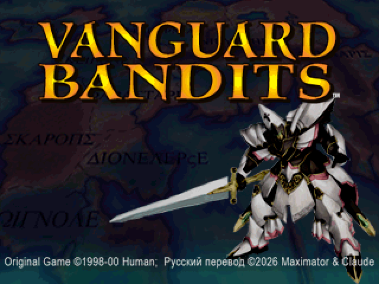
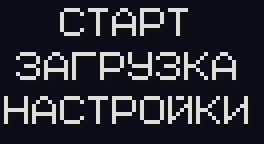
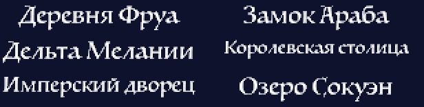
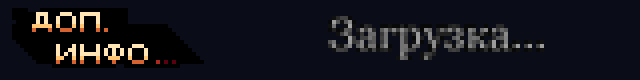
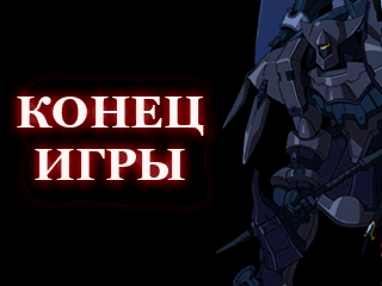

<div align="center">



# Vanguard Bandits — русский перевод

**Фанатский перевод тактической RPG Vanguard Bandits (PlayStation, 2000) на русский язык**


[Установка](#установка) · [Что переведено](#что-переведено) · [Как переводили](#как-переводили) · [Помочь с переводом](CONTRIBUTING.md) · [Глоссарий](texts/GLOSSARY.md)

</div>

---

## Об игре

**Vanguard Bandits** (в Японии — *Epica Stella*) — тактическая ролевая игра от Human Entertainment, изданная в США компанией Working Designs в 2000 году. Юный Бастион, выросший в глухой деревне Фруа, оказывается втянут в войну Королевства Фарастия и Империи Джунарис. Сражаются в игре на боевых роботах — АТАКах.

Официального русского перевода у игры не было. Этот проект переводит её целиком: сюжет, бои, интерфейс и графику с надписями.

## Установка

Перевод распространяется как **патч xdelta**. Самой игры в репозитории нет: нужен ваш собственный образ американской версии.

**1. Подготовьте образ.** Нужен образ CloneCD `Vanguard Bandits.img`:

| | Размер | CRC32 | MD5 |
|---|---|---|---|
| исходный образ | 570 973 872 байт | `FA90CA39` | `54770993a8668ea2b6ce288125219c68` |

Патч применяется только к образу с такой контрольной суммой. Образ с другой суммой (иной дамп или формат) не подойдёт.

**2. Скачайте патч** из папки [`patch/`](patch/) или со страницы [Releases](../../releases).

**3. Примените патч** одним из способов:

- **Rom Patcher JS** (в браузере, ничего не нужно ставить): откройте [marcrobledo.com/RomPatcher.js](https://www.marcrobledo.com/RomPatcher.js/), выберите `Vanguard Bandits.img` и `Vanguard Bandits RUS.xdelta`, нажмите «Apply patch».
- **Delta Patcher** (Windows, macOS, Linux): *Original file* — `Vanguard Bandits.img`, *XDelta patch* — `Vanguard Bandits RUS.xdelta`.
- **Командная строка**:
  ```sh
  xdelta3 -d -B 1073741824 -s "Vanguard Bandits.img" "Vanguard Bandits RUS.xdelta" "Vanguard Bandits RUS.bin"
  ```

**4. Запустите игру.** Сохраните результат как `Vanguard Bandits RUS.bin`, положите рядом [`Vanguard Bandits RUS.cue`](patch/Vanguard%20Bandits%20RUS.cue) и откройте `.cue` в эмуляторе (DuckStation, Mednafen, ePSXe и др.).

| | Размер | MD5 |
|---|---|---|
| готовый образ | 571 011 504 байт | `fd0e726ffbe727e7e60f183468685f8b` |

## Что переведено

| Что | Строк | Слов |
|---|---:|---:|
| Сюжетные сцены | 5 327 | 45 377 |
| Диалоги в боях | 2 919 | 22 482 |
| Выкрики в анимации боя, 46 персонажей | 2 537 | 7 359 |
| Разговоры у костра и подсказки Пака | 281 | 3 514 |
| Интерфейс: меню, магазин, предметы, настройки, карта памяти | 671 | 1 241 |
| **Итого** | **11 735** | **≈80 000** |

**Графика.** Перерисованы главный экран и его меню, 53 заставки с названиями местностей, названия регионов на карте путешествий, плашка «ДОП. ИНФО», экран загрузки и «КОНЕЦ ИГРЫ».

**Шрифты.** Кириллица добавлена во все три шрифта игры: основной, мелкий боевой и самый мелкий 8×8.

<div align="center">

&nbsp;&nbsp;&nbsp;





</div>

**Осталось на английском:**

- сокращения характеристик **HP, AP, FP, BAS, POW, DEX, AGL, DEF, WEP, LV**, как в оригинале;
- заставки с названиями компаний (Working Designs, Human, S-NEO);
- японские реплики, которые в американской версии не используются.

## Как переводили

**Имена и названия** сверены с английским текстом игры, [статьёй в Википедии](https://en.wikipedia.org/wiki/Vanguard_Bandits) и прохождением на [LP Archive](https://lparchive.org/Vanguard-Bandits/), а затем сведены в [глоссарий](texts/GLOSSARY.md). Транскрипция выбрана по звучанию, с учётом русской практики: Kamorge — Каморж, Faulkner — Фолкнер, Sadira — Садира, Pharastia — Фарастия.

**Голоса персонажей.** Перевод Working Designs славится живыми репликами и шутками, и мы старались их сохранить, а не пересказать. У каждого заметного персонажа своя манера речи:

- **Заков** говорит с немецким акцентом. Звонкие согласные у него оглушаются, а генерала он называет «Фоккнер»: «Што?! И почему это я и мои люди лишены участия в грятущей слафной попеде?!»
- **Клэр** — капризная модница, которая через слово вставляет «типа» и «реально».
- **Халак** — пожилая телохранительница принцессы, говорит с перевёрнутым порядком слов: «Больное бедро у меня. На твой глубокий массаж надеюсь я!»
- **Барлоу** думает только о еде и конфетах, **Эндрю** — неисправимый бабник, **Франко** не может удержаться от дурацких анекдотов, **Нана** через слово повторяет «Кю-кю!».

Подробные правила для каждого персонажа собраны в [руководстве по стилю](docs/STYLE.md).

**Технические ограничения.** Строки проверяются автоматически:

- ширина — до 238 пикселей в окне диалога и до 150 пикселей у выкриков;
- число строк в окне;
- смешение латиницы и кириллицы в одном слове.

Где русская фраза не помещалась, её переформулировали, а не обрезали. Всё проверялось в эмуляторе по скриншотам.

## Помочь с переводом

Нашли опечатку, неудачную фразу или текст, который не помещается в окно? Все тексты лежат в папке [`texts/`](texts/) в виде JSON, рядом с оригинальными английскими строками. Исправьте поле `"ru"` и отправьте pull request. Подробности в [CONTRIBUTING.md](CONTRIBUTING.md).

Скриншоты с ошибками можно присылать через [Issues](../../issues).

## Сборка из исходников

Если вы хотите собрать образ сами, например после правок в текстах, инструкция в [docs/BUILD.md](docs/BUILD.md). Нужен Python 3 и ваш собственный образ игры.

## Структура репозитория

```
patch/      готовый патч xdelta и .cue
texts/      тексты перевода (JSON) и глоссарий
  story/    сюжетные сцены
  battle/   диалоги в боях
  quips/    выкрики в анимации боя
  camp/     разговоры у костра и подсказки Пака
  ui/       интерфейс
scripts/    инструменты: сборка, проверки, форматы файлов игры
assets/     перерисованная графика
docs/       руководство по стилю, инструкция по сборке, картинки
```

## Авторы

Перевод и техническая часть: **Maximator & Claude**, 2026.

Vanguard Bandits © Human Entertainment, S-NEO; английская локализация © Working Designs, 2000. Это некоммерческий фанатский перевод. Репозиторий не содержит игры: патч работает только с вашей собственной копией. Английские строки в `texts/` приведены как исходник для перевода.
